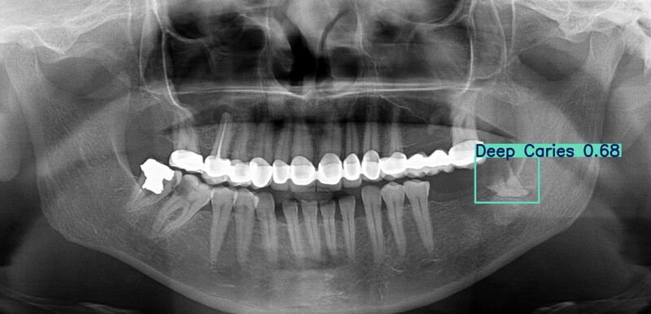

# 🦷 Dental Caries Detection: Tooth Disease Classification & Detection on X-rays

A computer vision system that finds dental diseases on panoramic X-rays. It has two models: one labels a single cropped tooth, and one finds and labels every disease region on a full X-ray by itself. Built on the DENTEX dataset (MICCAI 2023 challenge).

## 🧠 Machine Learning Pipeline

### Architecture Overview

The project uses two models that solve two different problems:

1. **MobileNetV2 (Classification)** - Looks at one cropped tooth and says which disease it has
2. **YOLOv8n (Detection)** - Looks at a full X-ray, draws a box around each disease area, and labels it

Both models predict 4 disease types: **Caries, Deep Caries, Impacted, Periapical Lesion**.

### Technical Implementation

- **Data Preparation**: Cropped 3,529 tooth regions out of 705 X-rays using the dataset's bounding boxes
- **Transfer Learning**: MobileNetV2 starts from ImageNet weights, YOLOv8n starts from COCO weights
- **Format Conversion**: Wrote my own converter from COCO boxes (corner + size, in pixels) to YOLO boxes (center + size, from 0 to 1)
- **Apple GPU Training**: Both models trained locally on Apple Silicon (MPS)

## ⚖️ Class Imbalance Experiments

### The Problem

The data is very uneven: **Caries has 2,189 images, Periapical Lesion has only 158**. The first classifier reached 77% accuracy, but it almost never predicted Periapical Lesion (recall 0.03).

### What I Tried

- **Class-weighted loss (3 strengths)**: Rare classes get a bigger penalty when the model gets them wrong
- **Data augmentation**: Random rotation, flip, and brightness/contrast changes
- **Result**: Each fix helped one class but hurt another. None was clearly better than the baseline
- **Likely reason**: Only the last layer was trained (the rest of MobileNetV2 was frozen), so the model could not learn fine X-ray texture differences

## 📊 Results

| Model | Result |
|---|---|
| MobileNetV2 classifier | 77% accuracy (Periapical Lesion is still the weakest class) |
| YOLOv8n detector | mAP50 = 0.478, mAP50-95 = 0.31 |
| Detector recall per class | Impacted 0.91 · Caries 0.41 · Periapical Lesion 0.32 · Deep Caries 0.32 |

The same imbalance pattern shows up in both models, which points to the data (not one model) as the real bottleneck.

## 🎬 Demo

**Live detector demo (Streamlit Cloud):** `ADD_YOUR_STREAMLIT_LINK_HERE`



*The detector finds a Deep Caries region on a full panoramic X-ray and labels it with a confidence score of 0.68.*

## 🛠️ Technology Stack

**Deep Learning & Computer Vision**
- PyTorch, torchvision
- Ultralytics YOLOv8
- Pillow
- scikit-learn

**Web Application & API**
- FastAPI
- Uvicorn
- Streamlit

**Deployment**
- Docker
- Streamlit Community Cloud

## 🎮 Features

- **Two Ways to Predict**: Classify one cropped tooth, or detect diseases on a whole X-ray
- **Bounding Boxes**: Each detection shows the disease name and a confidence score
- **REST API**: `POST /detect` returns every detection as JSON (class, confidence, box)
- **Live Web Demo**: Upload an image in the browser and see results instantly
- **Portable**: The API runs the same way anywhere with Docker

## 📁 Project Structure

```
├── data_prepartion.ipynb   # Crop teeth from X-rays + train/val split
├── trainingdata.ipynb      # Train MobileNetV2 + class imbalance experiments
├── convert_to_yolo.py      # Convert COCO annotations to YOLO format
├── train_yolo.py           # Train the YOLOv8n detector
├── data.yaml               # YOLO dataset config (paths + class names)
├── app.py                  # Streamlit demo: classifier
├── app_detection.py        # Streamlit demo: detector (deployed live)
├── main.py                 # FastAPI backend (/detect endpoint)
├── caries_model.pth        # Trained classifier weights
├── models/best.pt          # Trained YOLO detector weights
├── Dockerfile              # Container for the API
├── requirements.txt        # Python dependencies
└── packages.txt            # System libraries for Streamlit Cloud
```

## 🏆 Technical Achievements

- **Two Complete Models**: A classifier and a detector built from the same raw annotations
- **Custom Data Pipeline**: Tooth cropping and COCO-to-YOLO conversion written from scratch
- **Honest Imbalance Study**: Tested 4 fixes, measured each one, and explained why none fully worked
- **Real Deployment Debugging**: Fixed 3 rounds of missing system libraries on Streamlit Cloud, one error at a time

## 🔮 Future Improvements

- Unfreeze part of MobileNetV2 so it can learn X-ray-specific features
- Combine both models: the detector finds teeth, the classifier confirms the disease
- Add a `/predict` classifier endpoint to the API
- Show a "low confidence, needs review" warning in the demo

> ⚠️ This is a portfolio project, not a medical tool. Predictions need review by a dentist.